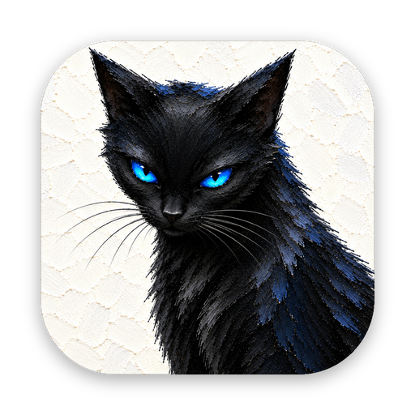
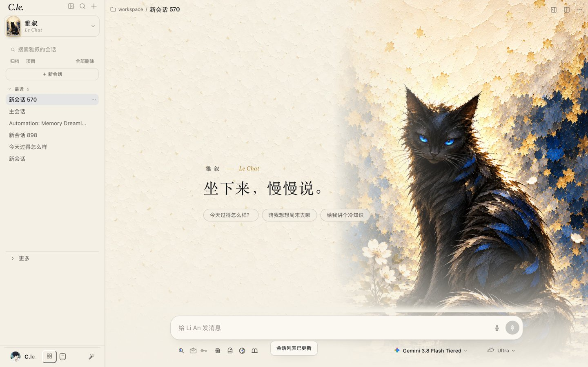
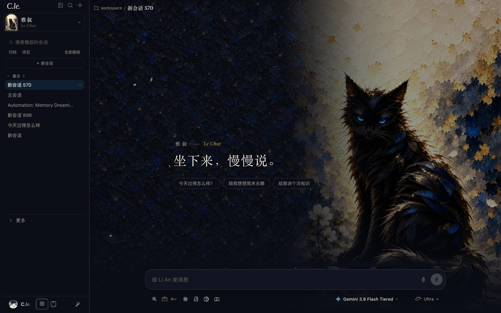

<p align="center">
  
</p>

<h1 align="center">C.le. Studio</h1>

<p align="center">一只守着白花的黑猫 · Li An 的工作室<br>
基于 <a href="https://github.com/openclaw/openclaw">OpenClaw</a> 的桌面 AI 助手界面</p>

---

C.le. 是一套为 OpenClaw 做的完整界面与人格：白天是一张安静的纸，夜里是一间墨色的画室。陪你工作的是 **Li An**——一只冰蓝眼睛的短毛黑猫，画风来自作者自己的刮刀油画。

> 名字的来历：梁才酷 → LCK → “K k” → **C.le.**




## 有什么

- **五个房间**，各有独立会话、人格与画作，切换时 Li An 眨一下眼
  - 雅叙 · Le Chat（日常闲聊）
  - 营造 · Œuvre（项目与代码/Notebook 工作台，称呼“老板”）
  - 堇思 · Pensée（深度想法与推演）
  - 习作 · Étude（学习书桌 v2：今日看板、交互讲义、错题回流、笔记本 v2、词库与自测、学习契约）
  - 挥洒 · Carte Blanche（无限模式）
- **开场**：一启动就进开场——WebGL 分层电影式特写，花枝在前景虚化，金箔飘落，猫眼沿画中的折痕缓缓睁开
- **工作过程**：旁白照常铺开，工具按类型带圆点，连续的工具收成一行“已运行 N 步”，状态行随阶段换动画（凝神 / 思考 / 读取 / 执行 / 写作 / 落款）；新到的回复带着透明渐变一段段写进来
- **推理强度滑杆**：一条会流动的材质轨道，每一档一种材质——墨烟、石墨、靛蓝丝、普鲁士蓝油彩、冰蓝玻璃、金箔、冰蓝火上的金箔；四档深度思考：一瞥 · 守望 · 追猎 · 夜巡
- **输入框上的小猫**：卡通贴纸风的 Li An，歇着 / 打字 / 干活 / 开心 / 打盹，会眨眼
- **侧边栏**：收起时整块滑走，左边缘的把手越近越亮，碰一下以浮动卡片呼出
- **玻璃窗口与双平台适配**：macOS 与 Windows 10/11 原生无边框桌面壳；Windows 端专为右上角窗口控制区（更新 / 最小化 / 最大化 / 关闭）与拖拽区做了各模式顶栏避让适配
- **自动拉取更新与人格同步**：内置 Release 自动检测、断点续传与失败回滚，并提供 `update.ps1` / `--update` 一键拉取最新代码、同步五模式人格模板与皮肤（严格保留用户本地 `USER.md`、`DREAMS.md`、记忆与会话隐私）
- 内置浏览器（默认小窗悬浮）、工作台（Monaco 代码编辑 + `.ipynb` 笔记本内核执行）、派对空间与灵感圆桌、深度研究、连接器、定时任务、语音听写与朗读
- 所有文字对比度 ≥ 4.5

## 结构

| 路径 | 内容 |
|---|---|
| `services/cle-studio/` | C.le. 界面插件（OpenClaw 原生插件 UI：`controlUi.entry` + 主题） |
| `services/cle-studio/src/` | 房间、开场、输入区、工作过程、学习模式等源码，`node build.mjs` 构建 |
| `services/cle-studio/static/` | 画作、开场着色器、伴侣猫素材 |
| `services/cle-studio/scripts/art/` | 从原画切分图层、抠图、合眼的脚本 |
| `personas/` | 各房间的人格文件（SOUL / IDENTITY / AGENTS） |
| `services/mode-architecture/` | 多模式架构扩展 |
| `desktop/macos/` | macOS 原生壳（WKWebView、原生浏览器窗口、听写）；Info.plist 里 `CLEBrand = cle` 时启用 C.le. 外观 |
| `docs/redesign/` | 设计系统（`CLE-DESIGN.md`）、迁移清单、验收记录 |

## 本地试用（开发者）

需要 OpenClaw 2026.10.x 和 Node 24。

```bash
cd services/cle-studio
npm install
node build.mjs
```

然后在 OpenClaw 配置里：

1. 把 `services/cle-studio` 加进 `plugins.load.paths` 和 `plugins.allow`；
2. 打开 `gateway.controlUi.experimental.customPlugins: true`；
3. 重启网关，打开 `http://127.0.0.1:<端口>/cle/`。

完整迁移步骤见 [`docs/redesign/CUTOVER.md`](docs/redesign/CUTOVER.md)。

测试：

```bash
node --test tests/cle-*.test.mjs tests/*companion*.test.mjs
```

## 状态

改版仍在测试环境中验收，还没有打包成可直接双击的 C.le. App。打包版会发布在 [Releases](../../releases)。

## 来源

C.le. 由 [超級碧琪](https://github.com/Cle0726/super-pinkie) 改版而来，旧版说明保留在 [`docs/legacy/`](docs/legacy/README-超級碧琪.md)。第三方组件声明见 [`desktop/macos/THIRD_PARTY_NOTICES.md`](desktop/macos/THIRD_PARTY_NOTICES.md)。

代码以 [MIT](LICENSE) 许可发布。画作与 Li An 形象 © C.le.（梁才酷），保留所有权利，不在 MIT 授权范围内。
